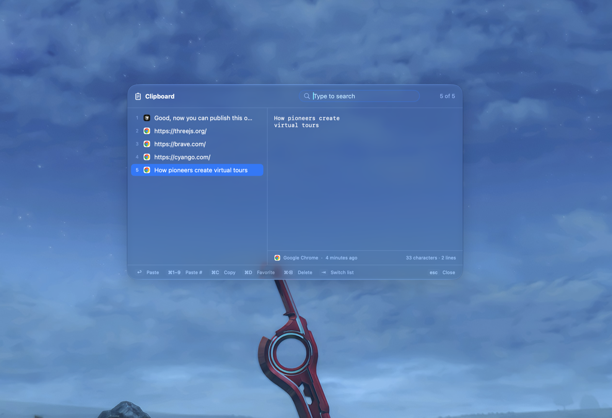

# copypasteX

[](https://github.com/joaomelorodrigues/copypasteX/releases/latest)


[](LICENSE)

A fast, lightweight clipboard manager for the Mac. Copy text, images or files as usual. Press
**⇧⌘V** to bring back anything you copied, type a few letters to find it, and press Return to paste.

copypasteX is a from-scratch Swift rewrite of [Flycut](https://github.com/TermiT/Flycut), the
clipboard manager for developers, rebuilt for current macOS.



**[Download the latest version](https://github.com/joaomelorodrigues/copypasteX/releases/latest)**

## Features

- **Instant search.** The search field is ready as soon as the bezel opens. Just type; accents and
  input methods work as in any text field.
- **Images, videos and files.** Screenshots and copied images come back as images. Files copied in
  Finder, including videos, come back as files. All with Quick Look previews.
- **List and preview side by side.** Recent clippings on the left, the selected one in full on the
  right, with the app it came from and when.
- **Keyboard first.** ⌘1–⌘9 pastes a clipping straight away, ⌘D keeps one in favorites, ⌘⌫ deletes.
  Your mouse works too.
- **Favorites.** Keep snippets you reuse in a list of their own, saved for good.
- **Menu bar.** Recent clippings and favorites are one click away. Option-click the icon to pause
  recording.
- **Private by design.** Nothing leaves your Mac. Passwords and content marked concealed are never
  read, and you choose which apps to ignore.
- **Built for current macOS.** Liquid Glass on macOS 26 and later, guided setup for macOS's
  clipboard privacy controls, launch at login.
- **Light.** About 20 MB of memory and no CPU at idle. No third-party code.
- **Flycut friendly.** Same ⇧⌘V shortcut, an optional hold-and-release mode, and one-click import
  of your Flycut history and favorites.

## Install

Requires macOS 14 Sonoma or later, on Apple silicon or Intel.

1. Download `copypasteX-<version>.dmg` from the
   [latest release](https://github.com/joaomelorodrigues/copypasteX/releases/latest), open it, and
   drag **copypasteX** to **Applications**.
2. Open copypasteX. The first time, macOS blocks it, because the app isn't notarized by Apple.
   Click **Done**, then open **System Settings ▸ Privacy & Security**, scroll down to *Security*,
   and click **Open Anyway** next to the copypasteX message. Confirm with your password. You only
   do this once.

   If you prefer Terminal:
   ```sh
   xattr -dr com.apple.quarantine /Applications/copypasteX.app
   ```
3. copypasteX opens on its **Permissions** tab and lives in the menu bar (there's no Dock icon).
   Grant both permissions:
   - **Accessibility** lets copypasteX press ⌘V for you. Without it, picking a clipping only copies it.
   - **Paste from Other Apps** (macOS 15.4 and later): macOS asks before apps read the clipboard in
     the background. Choose **Allow** for copypasteX, then quit and reopen it.
4. Optional: turn on **Launch at login** in Settings ▸ General.

When you install a new version, macOS may ask for the Accessibility permission again. Remove
copypasteX from the list in *Privacy & Security ▸ Accessibility* with −, then add it again.

## Using the bezel

Press **⇧⌘V** (you can change it in Settings) and start typing to filter. Press **Return** to paste
the selected clipping into the app you were using.

| Key | Action |
|---|---|
| Type | Search clippings, file names and kinds (`video`, `image`, `pdf`) |
| ↓ / ↑ | Next / previous clipping (or press the shortcut again) |
| ⌘↓ / ⌘↑, Home / End, Page Up / Page Down | Last / first, ±10 |
| ↩ | Paste the clipping (or copy it, if *Paste after choosing* is off) |
| ⌘1 – ⌘9, ⌘0 | Paste clipping 1–10 straight away |
| ⌘C or keypad Enter | Copy without pasting |
| ⌘D | Move to favorites (or back to history) |
| ⌘⌫ | Delete the clipping |
| ⇥ | Switch between history and favorites |
| ⌘S | Save the clipping to the Desktop (text as `.txt`, images in their own format) |
| ⌘, | Settings |
| esc | Clear the search, or close |

Click a row to select it, and double-click to paste.

With **Sticky bezel** on (the default), the bezel stays open until you choose. Turn it off for the
classic Flycut style: hold ⇧⌘, tap V to step through the list, and let go to paste.

## Images, videos and files

- **Images** copied to the clipboard, such as screenshots (⌃⇧⌘4), "Copy Image" in a browser, or
  pictures from Preview and Photos, are kept with their size and format, and paste back as images.
- **Files** copied in Finder, including videos, photos and documents, are kept as references.
  Pasting puts the files themselves back, so they land in Finder, Mail or a chat app like any copied file.
- The preview shows a Quick Look thumbnail: the picture, a frame of the video, or the first page of
  a document, with the format and size underneath.
- When something holds both text and a picture (Excel cells, Keynote shapes), the text is kept.
  The exception is a browser's "Copy Image", where the text is just the image's web address, so the
  image is kept.
- Images over 50 MB are skipped. Turn images or files off in **Settings ▸ History ▸ Images and Files**.

## Menu bar

The menu lists your most recent clippings (click to paste) and your favorites, and has Search,
Pause, Merge All (combines your text clippings into one), and Clear History. Option-click the icon
to pause or resume recording, for example while handling passwords from an app that doesn't mark
them as concealed.

## Settings

- **General:** the shortcut, launch at login, sticky bezel, wrap-around, source app icons, and
  whether choosing a clipping pastes it or only copies it.
- **History:** how many clippings to keep (100 by default), whether history survives quitting,
  duplicates, images and files, how many clippings the menu shows, ignored apps, Flycut import.
- **Permissions:** live status of both permissions, with buttons to fix them.

## Privacy

- Nothing leaves your Mac. There's no network code.
- Content marked concealed or transient by password managers (`org.nspasteboard.*` types) is never
  read. copypasteX checks what *kind* of content is on the clipboard before reading any of it.
- Apps on the ignored list (Keychain Access, Passwords, 1Password, Bitwarden, KeePassXC by default)
  are never recorded.
- History is stored in `~/Library/Application Support/copypasteX/` and only you can read it. Image
  data is deleted when its clipping is. Copied files aren't duplicated; only their location is saved.
- Turn off *Keep history after quitting* to keep history in memory only. Favorites are always saved.

## Coming from Flycut

1. In copypasteX, choose **Settings ▸ History ▸ Import from Flycut…** to bring over your history
   and favorites. copypasteX also offers this the first time it opens.
2. Quit Flycut and remove it from your login items. Both apps want ⇧⌘V, and if both run, macOS
   triggers both on the same keypress.

| | Flycut | copypasteX |
|---|---|---|
| Content | Text only | Text, images, and files (videos, photos, documents) with previews |
| Bezel | One clipping at a time | List and full preview side by side, source app icons |
| Bezel keys | Single letters (`s`, `f`, `F`, digits) | ⌘ shortcuts, so letters and digits can be searched |
| Clipboard privacy (macOS 15.4+) | Not handled | Detects the "Paste from Other Apps" setting and walks you through it |
| Passwords | Skips 1Password and concealed types | Skips every [nspasteboard.org](http://nspasteboard.org) private type, plus apps you choose |
| Code | Objective-C, ~13k lines plus vendored libraries | Swift 6 with strict concurrency, ~3k lines, no dependencies |

Updating from FlycutX, this project's earlier name? Your history and settings move over
automatically the first time copypasteX opens; only the permissions need granting again.

## Why it's light

- **Polling that costs almost nothing.** macOS has no clipboard-change notification, so every
  clipboard manager polls. copypasteX checks only a change counter twice a second, with a timer
  tolerance that lets macOS batch the wake-ups. Content is read only after a change.
- **Debounced, off-main-thread saves.** A burst of copies becomes one atomic write a second later.
- **Nothing runs while hidden.** The menu is built when you open it, the bezel is created on first
  use and reused, and the Settings window is released when closed.
- **Bounded work.** Text over 2 MB and images over 50 MB are skipped, previews render the first
  5,000 characters, and titles read only the start of each clipping.
- **Media done cheaply.** Identical images are stored once, compressed formats are kept instead of
  the TIFF copies apps add, a TIFF version is only produced when an app asks for one, and thumbnails
  are made only for the clipping you're looking at.

## Build from source

Requires Xcode 26 or later.

```sh
xcodebuild -project copypasteX.xcodeproj -scheme copypasteX -configuration Release \
  -derivedDataPath build/DerivedData build
cp -R build/DerivedData/Build/Products/Release/copypasteX.app /Applications/
```

Or open `copypasteX.xcodeproj` and press ⌘R. To run the tests, choose the **CopypasteCore** scheme
and press ⌘U, or run `swift test` in `Packages/CopypasteCore`.

The project is signed "to run locally" (ad hoc), which gives every build a new identity, so macOS
forgets the Accessibility permission after each rebuild. To avoid that, sign with your Apple
Development certificate, either by setting your team in *Signing & Capabilities* or on the command line:

```sh
xcodebuild … CODE_SIGN_STYLE=Manual DEVELOPMENT_TEAM=<TEAMID> \
  CODE_SIGN_IDENTITY="Apple Development: <Your Name> (<ID>)" build
```

The bundle identifier is `com.copypastex.copypasteX`; you can change it in the target's build settings.

### Making a release

```sh
scripts/release.sh 1.1.0
gh release create v1.1.0 dist/* --title "copypasteX 1.1.0" --notes "…"
```

The script builds a universal app and puts a DMG, a zip and SHA-256 checksums in `dist/`. Releases
are signed ad hoc and not notarized. To remove the first-open approval step for users, sign with a
Developer ID certificate and notarize the app with `xcrun notarytool`.

### Project layout

```
copypasteX.xcodeproj      Xcode project (folders are synchronized, so new files are picked up automatically)
copypasteX/
  App/                    AppDelegate (wiring), Preferences, ClipboardStore
  Clipboard/              PasteboardMonitor (capture), Paster (copy + ⌘V)
  HotKey/                 Carbon global hotkey, key combos, keyboard-layout mapping
  Bezel/                  Non-activating panel, controller (keymap), SwiftUI view
  MenuBar/                Status item and menu
  Settings/               SwiftUI settings and shortcut recorder
  Support/                Permissions, login item, Flycut import, display helpers, export, migration
  AppIcon.icon            Icon Composer icon (Liquid Glass; legacy icons are generated)
Packages/CopypasteCore/   Platform-independent logic with tests: Clipping, ClipList, CapturePolicy,
                          MediaLibrary, ListCursor, HistoryFile, Flycut importer
scripts/release.sh        Builds the DMG and zip for a GitHub release
```

## License

MIT. copypasteX is new code, inspired by Flycut (Gennadiy Potapov and contributors), which is based
on Jumpcut (Steve Cook).
